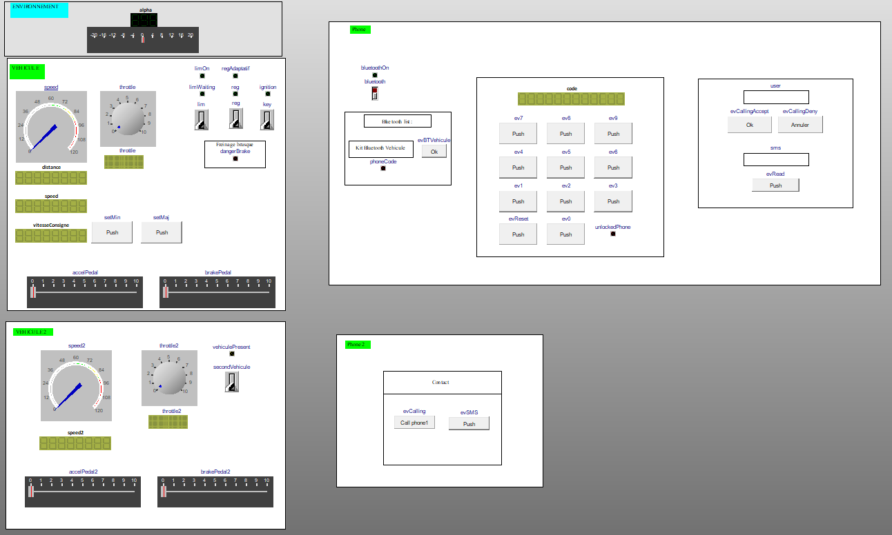
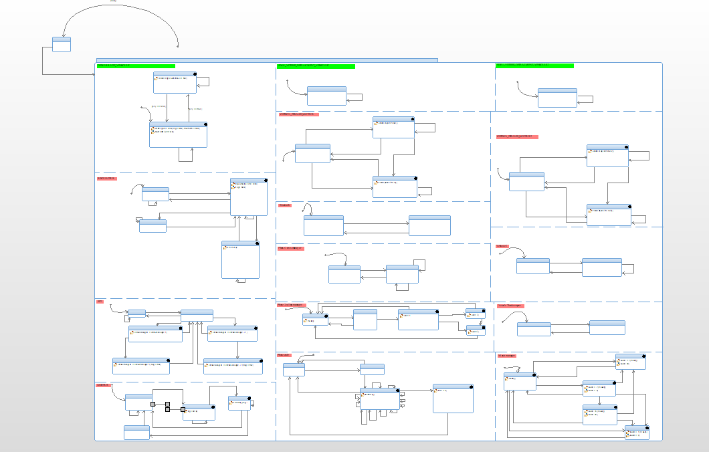
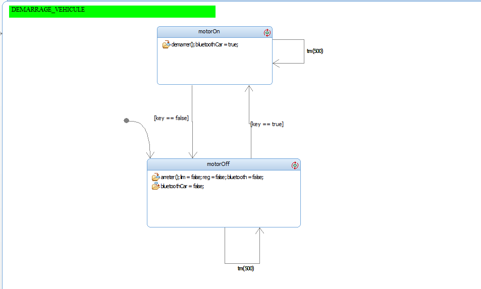
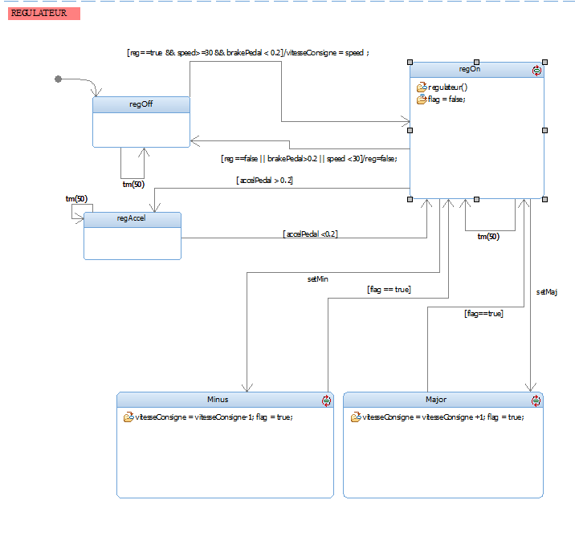
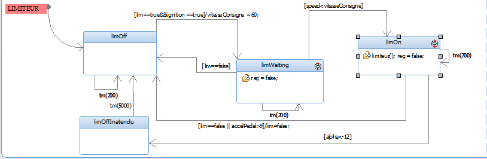
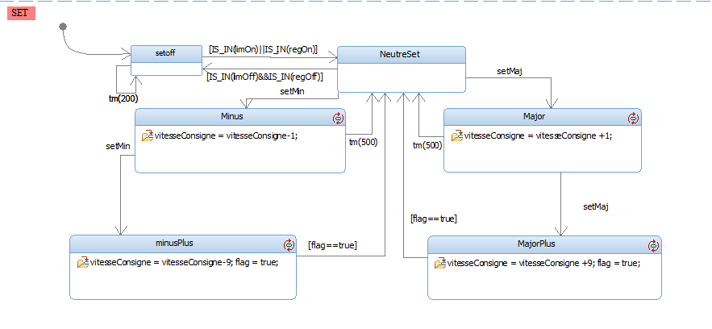
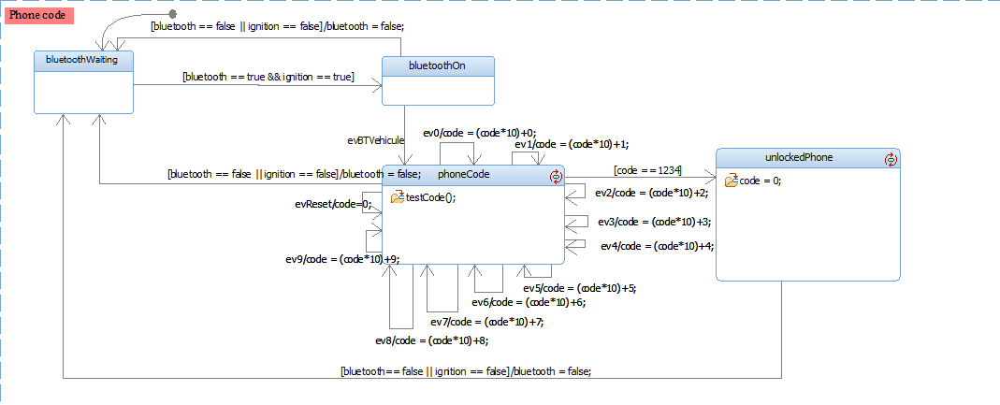
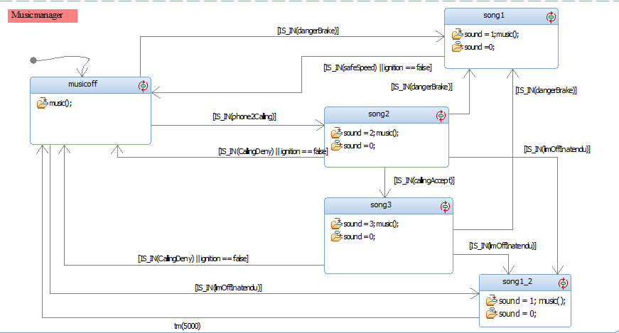

<div align="center">

# 🚗 Vehicle Speed Control – UML Statecharts

**Cruise control, speed limiter, adaptive cruise control and hands-free Bluetooth kit, modelled with UML statecharts in IBM Rhapsody and generated as C++**




<sub>Animated control panel used to drive the simulation: speed and throttle gauges, pedals, ignition key, cruise control / limiter switches, Bluetooth keypad and the second vehicle.</sub>

</div>

> [!NOTE]
> 🇫🇷 **This project was carried out in French.** State names, attributes and operations (`Freint` = braking, `regulateur` = cruise control, `limiteur` = speed limiter, `vitesseConsigne` = set speed…) are in French. This README is in English so the project can be read by a wider audience.

---

## 📖 About

Project for the **Spécification des systèmes à événements discrets** (*Specification of discrete-event systems*) course (academic project), 4th year, embedded systems track (September–November 2025), carried out as a **team of two students**.

The goal: **specify the behaviour of a car's speed-control functions with UML statecharts**, simulate them with Rhapsody's animation and an interactive control panel, and let Rhapsody **generate the C++ code** of the whole system.

All functions run as **parallel regions** of one statechart. They communicate through attributes and `IS_IN(state)` guards, and timed transitions (`tm(50)`, `tm(500)`) refresh the values.

<div align="center">

</div>

## ✨ Functions

### 🛞 Vehicle and pedals
- **Vehicle dynamics**: every 50 ms the `Calcul_Vitesse_Distance` state computes speed and distance from the engine throttle.
- **Pedals**: `Neutre` / `Accelerartion` / `Freint` states driven by two sliders. The brake has priority over the accelerator.
- **Ignition**: `motorOn` / `motorOff` driven by the key switch. Every other function is only active when the engine is on, and everything is reset when it is switched off.

<div align="center"></div>

### 🎯 Cruise control
- Engages when the switch is on, the speed is **above 30 km/h** and the brake is released. The **set speed** takes the current speed.
- `regulateur()` keeps the vehicle at the set speed.
- `regAccel`: the driver can still accelerate; regulation resumes when the pedal is released.
- Disengages when braking, when the switch is turned off or when the speed drops below 30 km/h.

<div align="center"></div>

### 🚦 Speed limiter
- `limOff` → `limOn`: the vehicle cannot go faster than the set speed.
- `limWaiting`: if the limiter is switched on below the set speed, the request is kept and applied when the speed reaches it.
- **Kick-down**: pressing the accelerator hard overrides the limiter.
- `limOffInatendu`: the limiter switches off **with an alarm** when a steep downhill makes the vehicle exceed the limit.

<div align="center"></div>

### ➕ Set buttons
Pressing **Set+ / Set−** changes the set speed by **±1 km/h**; a second press within 500 ms makes it **±10 km/h**.

<div align="center"></div>

### 📱 Hands-free Bluetooth kit
- Bluetooth on/off, then pairing with the vehicle.
- Phone unlock with a **4-digit PIN** typed on a 0–9 keypad (`code = code × 10 + digit`, the code is `1234`).
- **Incoming calls** (accept / reject) and **SMS** display.

<div align="center"></div>

### 🚙 Adaptive cruise control
- A **second vehicle** is simulated (its own dynamics, pedals and panel).
- When it is present in front and the cruise control is on, the `regAdaptatif` state is entered.
- A **sudden-braking alert** fires when the vehicle in front brakes hard.

### 🔊 Sound manager
A parallel region plays the warning sounds (danger braking, limiter cut-off, incoming call) with **priority given to safety warnings**.

<div align="center"></div>

## 🔌 Inputs and outputs

| Inputs | Outputs |
|---|---|
| accelerator and brake pedals (`accelPedal`, `brakePedal`) | `throttle`, `speed`, `distance` |
| ignition key (`key`) | `ignition` LED |
| cruise control / limiter switches, `Set+` / `Set−` | set speed (`vitesseConsigne`), state LEDs |
| Bluetooth switch, pairing button, keypad 0–9 | phone unlocked, call and SMS display |
| second vehicle presence and pedals | adaptive cruise control, danger-brake alert |

## 🗓️ Project timeline

The Git history follows the successive versions of the model:

| Version | Date | Added |
|---|---|---|
| V1 | 30 Sep 2025 | vehicle dynamics, accelerator pedal |
| V2 | 7 Oct 2025 | brake, ignition key, first cruise control |
| V3 | 14 Oct 2025 | complete cruise control |
| V4 | 30 Oct 2025 | speed limiter, Set buttons, Bluetooth kit, adaptive cruise control, sounds |
| Final | 14 Nov 2025 | SMS, unexpected limiter cut-off, full shutdown with the engine |

## 🚀 Open the project

Requirements: **IBM Rhapsody** (C++ edition, the project was built with 9.0.2) and **Microsoft Visual C++** on Windows.

1. Open `rhapsody/HelloWorld2.rpyx` in Rhapsody.
2. Generate and build the `CodesGeneres` component (configuration `ModeAnimation`).
3. Run it with animation and use the control panel.

The generated C++ is already in [`rhapsody/CodesGeneres/ModeAnimation`](rhapsody/CodesGeneres/ModeAnimation). [`_SysVehicule.cpp`](rhapsody/CodesGeneres/ModeAnimation/_SysVehicule.cpp) contains the state machine.

> [!IMPORTANT]
> The sound files (`alarm.wav`, `call.wav`, `speak.wav`) are **not included** because they come from third-party websites. To get sound, add your own `.wav` files with these names in `rhapsody/CodesGeneres/ModeAnimation/`.

## 📁 Repository structure

```
rhapsody/
├── HelloWorld2.rpyx               # Rhapsody project
├── HelloWorld2_rpy/               # model units: _MonPkg (statecharts), IHM_Objets (panel)…
└── CodesGeneres/ModeAnimation/    # generated C++ code and makefile
docs/                              # screenshots used in this README
```

## 🧠 What I learned

- Specifying reactive behaviour with **hierarchical and parallel statecharts**: states, guards, entry actions, timed transitions, `IS_IN` synchronisation.
- Turning informal requirements ("the brake always disengages the cruise control", "the limiter waits until the set speed is reached") into **unambiguous transitions**.
- **Model-driven development**: the C++ code is generated from the model, and the model is validated by animation before any code is written by hand.
- Thinking about priorities and safety: brake over accelerator, warning sounds over notifications, everything off when the engine is off.

## 🙏 Credits

- Base Rhapsody project (control panel framework, predefined packages): course team.

## 👤 Author

**Sivaharan Kumara Segaram**, embedded systems engineering student. Project carried out with a teammate.
